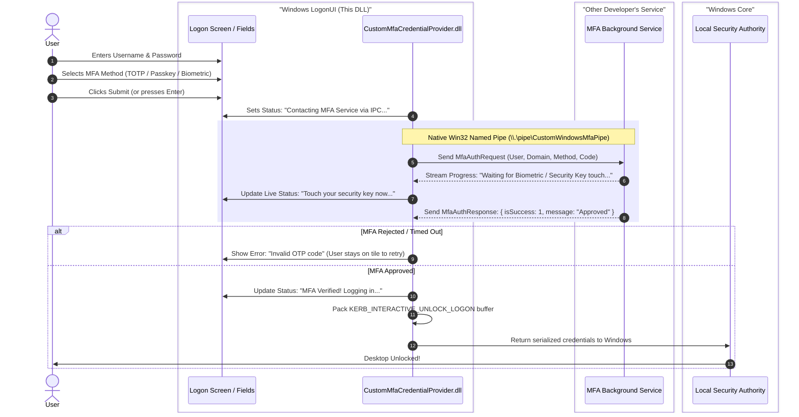

# Custom MFA Windows Credential Provider (C++)

A modular, enterprise-grade **Windows Credential Provider DLL** (`ICredentialProvider2` / `ICredentialProviderCredential2`) that integrates custom Multi-Factor Authentication (**TOTP, Passkeys/FIDO2, Biometrics, Smart Cards, Mobile Push**) into Windows Logon, Workstation Unlock, and CredUI elevation screens.

This project uses an **IPC-decoupled architecture**: the DLL handles the Windows UI, inputs, and LSA serialization, while offloading all heavy MFA logic (hardware drivers, biometric readers, web APIs) to an external background service via native **Win32 Named Pipes**.

---

## Architecture Overview



---

## Project Structure

```text
cpp_cred_provider/
├── CMakeLists.txt              # Unified CMake build configuration (DLL + Tools)
├── README.md                   # This documentation & IPC specification
├── include/
│   ├── IpcProtocol.h           # Shared IPC protocol contract & packet structs
│   ├── MfaIpcClient.h          # Win32 Named Pipe client interface
│   ├── MfaCredential.h         # ICredentialProviderCredential2 (Tile UI & inputs)
│   ├── MfaCredentialProvider.h # ICredentialProvider2 (Scenario controller)
│   ├── LsaHelper.h             # LSA package query & Kerberos serialization
│   ├── ClassFactory.h          # Standard COM IClassFactory
│   ├── guid.h                  # CLSID definitions
│   └── common.h                # COM memory and release helpers
├── src/
│   ├── dllmain.cpp             # DllMain, DllGetClassObject, DllRegisterServer
│   ├── ClassFactory.cpp        # COM factory instantiating provider
│   ├── MfaCredentialProvider.cpp # Scenarios, tile count, & enumeration
│   ├── MfaCredential.cpp       # Visual controls, dropdowns, & IPC trigger
│   ├── LsaHelper.cpp           # Resolves LSA package & builds KERB buffer
│   └── MfaIpcClient.cpp        # Native Win32 Named Pipe client
├── res/
│   └── MfaProvider.def         # Clean un-mangled COM exports
├── tools/
│   ├── MockMfaService.cpp      # Standalone IPC Server simulating the other developer's service
│   ├── TestHarness.cpp         # Safe desktop CredUI test harness (no lockout risk!)
│   └── TestIpcClient.cpp       # Standalone console test runner for the IPC client
└── scripts/
    ├── install.bat             # Administrator script to deploy DLL to System32 & register
    ├── uninstall.bat           # Administrator script to unregister and remove DLL
    ├── register.reg            # Manual registry file
    └── unregister.reg          # Manual registry removal file
```

---

## Building the Project

### Prerequisites
* Windows 10 / 11 or Windows Server (64-bit).
* Visual Studio 2019 / 2022 (with "Desktop development with C++" workload) or Build Tools.
* CMake 3.20 or later.

### Build Commands (64-bit MSVC)
Open **x64 Native Tools Command Prompt for VS** and run:

```cmd
cd cpp_cred_provider
cmake -B build -A x64
cmake --build build --config Release
```

This compiles:
1. `build\Release\CustomMfaCredentialProvider.dll` (The Windows Credential Provider DLL).
2. `build\Release\MockMfaService.exe` (Mock background MFA service).
3. `build\Release\MfaTestHarness.exe` (Desktop testing harness).
4. `build\Release\TestIpcClient.exe` (Console IPC test client).

---

## Safe Testing & Verification Workflow

> [!CAUTION]
> Always test your Credential Provider using the desktop harness first before installing it into `LogonUI.exe`!

### Step 1: Start the Mock MFA Service
In a separate command prompt, run:
```cmd
build\Release\MockMfaService.exe
```
This creates and listens on `\\.\pipe\CustomWindowsMfaPipe`.

### Step 2: Test IPC Communication
Verify that the IPC client can communicate with the server:
```cmd
build\Release\TestIpcClient.exe
```
You will see simulated progress updates and authentication verdicts.

### Step 3: Test the UI Safely in Desktop Mode (`CredUI`)
Register the DLL temporarily and run the desktop test harness:
```cmd
:: Register the DLL (Run as Administrator)
regsvr32.exe build\Release\CustomMfaCredentialProvider.dll

:: Launch desktop test harness (Normal user)
build\Release\MfaTestHarness.exe
```
* A CredUI dialog will pop up on your desktop with your **Custom MFA Login** tile.
* Select different MFA methods from the dropdown:
  * Switching to **Passkey** or **Biometric** hides the code box.
  * Switching to **TOTP** displays the 6-digit code box.
* Enter credentials, type `123456` in TOTP, and click **Submit**.
* The test harness will verify the returned `KERB_INTERACTIVE_UNLOCK_LOGON` serialization buffer!

### Step 4: Deploy to Windows Lock Screen
When desktop testing is validated:
1. Right-click `scripts\install.bat` and select **Run as administrator**.
2. Press **Win + L** to lock the workstation.
3. Switch to the **Custom MFA Login** tile and log in.

To uninstall:
* Right-click `scripts\uninstall.bat` and select **Run as administrator**.

---

## IPC Specification for the Other Developer

Share [`include/IpcProtocol.h`](include/IpcProtocol.h) or the following specification with the developer building the background MFA service:

### 1. Named Pipe Details
* **Pipe Name**: `\\.\pipe\CustomWindowsMfaPipe`
* **Pipe Mode**: `PIPE_TYPE_MESSAGE | PIPE_READMODE_MESSAGE | PIPE_WAIT`
* **Security**: Grant Read/Write access to `NT AUTHORITY\SYSTEM` and `Authenticated Users`.

### 2. Supported MFA Methods
```cpp
enum class MfaMethod : uint32_t {
    Totp = 0,        // 6-digit TOTP / OTP
    Passkey = 1,     // FIDO2 / WebAuthn security key
    Biometric = 2,   // Fingerprint / Face sensor
    SmartCard = 3,   // Smart Card / PKI
    Push = 4         // Mobile push notification
};
```

### 3. Packet Structures (1-byte alignment)
```cpp
#pragma pack(push, 1)

// DLL -> MFA Service
struct MfaAuthRequest {
    uint32_t magic;           // 0x4D464131 ("MFA1")
    uint32_t version;         // 1
    MfaMethod method;         // Chosen MFA method
    wchar_t username[256];    // Windows user name
    wchar_t domain[256];      // Windows domain / machine name
    wchar_t payload[256];     // User-typed OTP code, PIN, or extra challenge
};

// MFA Service -> DLL
struct MfaAuthResponse {
    uint32_t magic;              // 0x4D464131 ("MFA1")
    uint32_t version;            // 1
    MfaResponseType responseType;// 0 = Progress update, 1 = Final result
    uint8_t isSuccess;           // 1 = Approved, 0 = Rejected / Failed
    int32_t errorCode;           // 0 = Success, non-zero = error code
    wchar_t message[256];        // Text to display on the Windows lock screen
};

#pragma pack(pop)
```

The service can stream multiple packets with `responseType = Progress` (e.g., *"Waiting for fingerprint touch..."*) before sending the final verdict with `responseType = FinalResult`.
# custom_credentials_provider_windows
